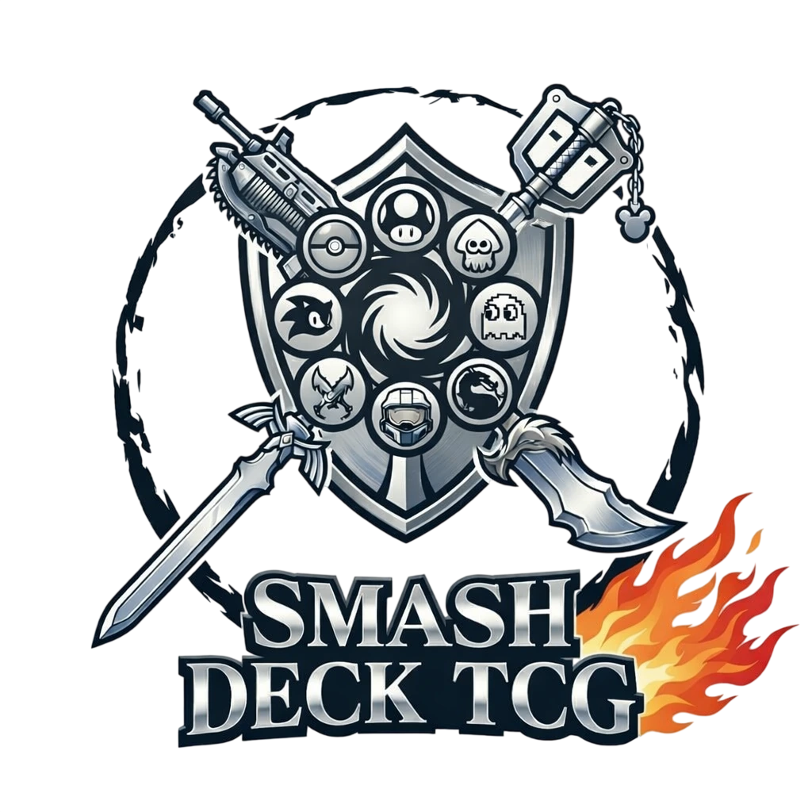
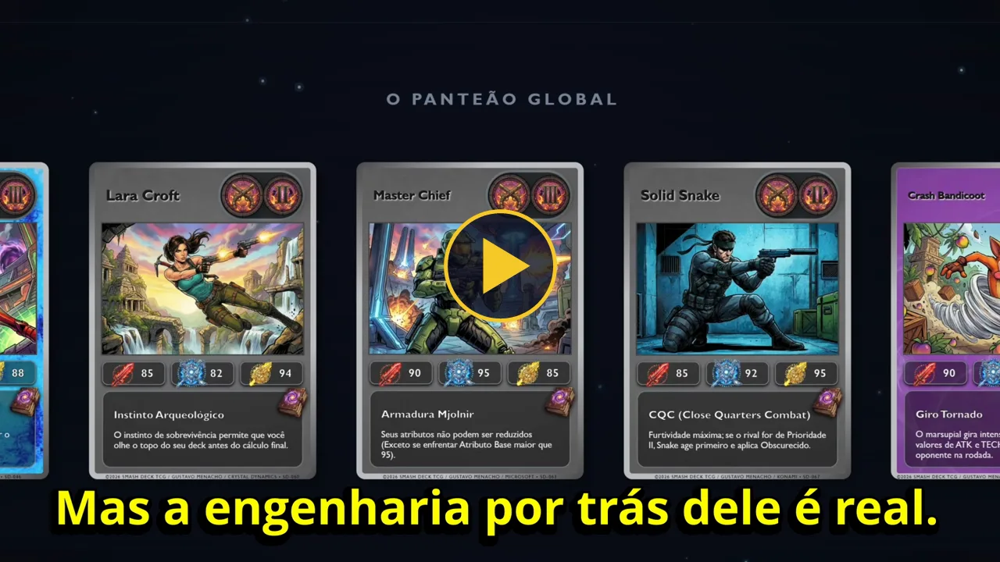
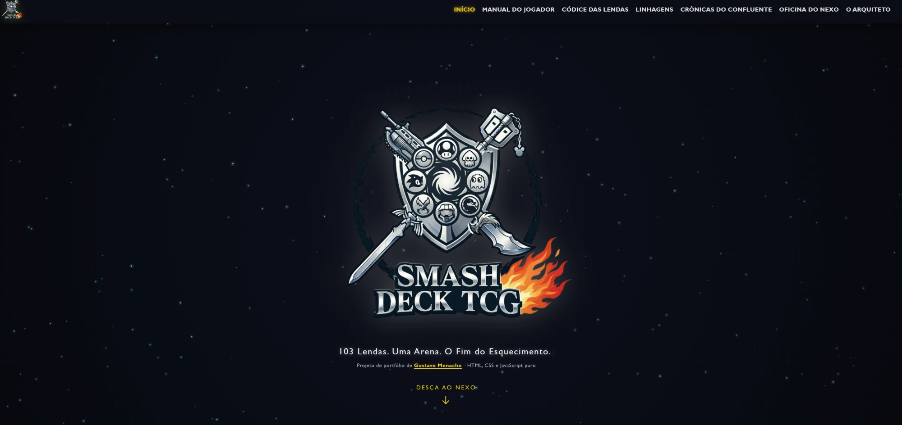
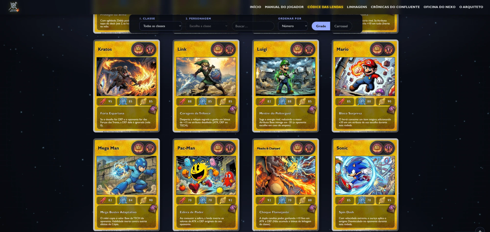

<div align="center">



# Smash Deck TCG

**103 Lendas. Uma Arena. O Fim do Esquecimento.**

Site de um jogo de cartas colecionáveis (TCG) autoral, com 103 lendas dos games, seis classes e um sistema de combate próprio.<br>
Feito com **HTML, CSS e JavaScript puro**, sem frameworks e sem bibliotecas.

[**🌐 Ver o site no ar**](https://smashdecktcg.netlify.app) · [Recursos](#-recursos) · [Como rodar](#-como-rodar) · [Decisões técnicas](#-decisões-técnicas) · [Autor](#-autor)


</div>

---

## 🎬 Trailer

<p align="center">
  <a href="docs/trailer.mp4">
    
  </a>
  <br><em>Clique na imagem para assistir ao trailer (1min31s, com som): um tour pelo site, do Manual do Jogador às Crônicas.</em>
</p>

> *Este jogo não existe. Mas a engenharia por trás dele é real.*

---

## 📸 Capturas de tela

<p align="center">
  
  <br><em>Página inicial</em>
</p>

<p align="center">
  
  <br><em>Códice das Lendas: filtros, busca, ordenação e a grade de cartas</em>
</p>

---

## 📖 Sobre o projeto

O **Smash Deck TCG** é um jogo de cartas criado por mim, do sistema de regras ao design das cartas. Este repositório guarda o **site oficial do jogo**, que é também o meu projeto de portfólio na transição de carreira do Direito para o desenvolvimento front-end.

Escolhi não usar frameworks de propósito: quis dominar os fundamentos da web (manipulação do DOM, módulos ES6, CSS avançado, responsividade, acessibilidade e desempenho) antes de partir para React ou similares.

### O jogo em 30 segundos

- **2 jogadores**, cada um com 50 cartas: mão de 5, Relicário de 5 prêmios e baralho de 40.
- A cada turno, o **Atacante** escolhe um atributo da **Tríade**: **ATK**, **DEF** ou **TECH**.
- No **Smash!**, cada jogador revela uma lenda ao mesmo tempo, e vence o maior **Poder Astral**:

  ```
  Poder Astral = Valor Base + Bônus de Classe + Modificadores de Habilidade
  ```

- O vencedor resgata um prêmio. Quem resgatar **5 prêmios** primeiro vence a partida.
- Cada carta tem um **Grimório** (habilidade especial) com **Prioridade de I a IV**, que define a ordem de resolução.

---

## ✨ Recursos

| Aba | O que tem |
|---|---|
| **Início** | Slogan animado, os três passos da rodada, altar interativo da Tríade e carrossel infinito de cartas |
| **Manual do Jogador** | "Regras em 1 minuto", anatomia da carta com destaque por parte, preparação, turno, cálculo do Poder Astral com exemplo, Estigmas, condições de vitória e glossário |
| **Códice das Lendas** | As 103 lendas + o Olvido em grade ou carrossel, filtro por classe e personagem, busca, ordenação por número, nome ou atributo, e filtros salvos no endereço da página |
| **Ficha da Lenda** | Página de detalhes de cada carta, com atributos, lore, prioridade e navegação para a lenda anterior e a próxima |
| **Linhagens** | As seis classes (Soberanos, Trevas, Combate, Sentinelas, Crime e Caos), com bônus, pontos fortes e tabela comparativa |
| **Crônicas do Confluente** | A história do universo em 4 capítulos, com índice e tempo de leitura calculado |
| **Oficina do Nexo** | Conceitos de produtos (tapete, pins, deck box, tubo, colecionáveis), apenas ilustrativos e sem venda |
| **O Arquiteto** | Sobre mim, como o site foi construído, desafios e soluções, e contatos |

**Interações das cartas:** inclinação 3D que segue o mouse, giro para ver o verso, zoom holográfico no carrossel, e tudo funcionando com **mouse, toque e teclado**.

---

## 🚀 Como rodar

O projeto usa **módulos ES6** (`import`/`export`), que o navegador **não carrega** abrindo o `index.html` direto (`file://`). É preciso um servidor local:

```bash
git clone https://github.com/gustavomenacho/smash-deck-tcg.git
cd smash-deck-tcg
npx serve .
```

Ou, no VS Code, use a extensão **Live Server** e clique em "Go Live".

Não há etapa de build nem dependências para instalar: o código que está no repositório é o código que roda no navegador.

### Conferir as imagens antes de publicar

Servidores Linux (Netlify, Vercel, GitHub Pages) diferenciam `Imagens/` de `imagens/`, e o Windows não. Este script confere se toda imagem citada no código existe com a caixa exata:

```bash
node tools/check-assets.mjs
```

---

## 🗂️ Estrutura

```
index.html               a página única (SPA) com todas as abas
css/
  global.css             variáveis, fundo, barras de rolagem, acessibilidade
  layout.css             menu (barra no desktop, gaveta no celular), abas, rodapé
  cards.css              a carta: faces, HUD, atributos, Grimório, giro 3D
  sections.css           Início (hero, altar, carrossel, zoom)
  codice.css, ficha.css, linhagens.css, lore.css,
  ritual.css, oficina.css, arquiteto.css
  reveal.css             entrada suave (fade-in) dos blocos
js/
  main.js                ponto de entrada
  utils.js               funções compartilhadas (escape de HTML, movimento reduzido…)
  cartas.js              banco de dados das 104 cartas (somente dados)
  classes.js             as seis classes (cores, bônus, textos)
  lendas.js              textos longos das lendas (ficha)
  contato.js             links de contato, num lugar só
  particles.js           partículas do fundo (canvas)
  modules/
    navigation.js        abas, histórico do navegador (#hash) e menu em gaveta
    cardRenderer.js      HTML da carta (fonte única, usada em todo o site)
    cardInteractions.js  inclinação e giro da carta (mouse, toque e teclado)
    cardZoom.js          zoom 3D da carta no carrossel
    home.js              slogan, pilares da Tríade e carrossel
    codice.js            galeria, filtros, busca e ordenação
    ficha.js             ficha da lenda
    linhagens.js         aba Linhagens
    lore.js              Crônicas do Confluente
    ritual.js            Manual do Jogador
    oficina.js           Oficina do Nexo
    arquiteto.js         assinatura que "se escreve" ao aparecer na tela
    reveal.js            fade-in dos blocos de todas as abas
fontes/                  Lora (woff variável, licença OFL)
imagens/                 artes, selos, ícones, fundos e marca (WebP)
tools/
  check-assets.mjs       confere se todas as imagens existem (com a caixa exata)
```

---

## 🧠 Decisões técnicas

**Orientado a dados.** Cada carta é um objeto em `js/cartas.js`, e o HTML nasce de uma única função, `renderCard()`. Para adicionar uma lenda, basta incluir um objeto; Início, Códice e Ficha passam a mostrá-la sem mais nenhuma mudança.

**SPA sem framework.** Cada aba tem um `#hash` próprio, tratado com `history.pushState`. O botão Voltar funciona, links diretos abrem a aba certa, e os filtros do Códice ficam no endereço (`#codice?classe=trevas&ordem=atk`), prontos para compartilhar.

**Carregamento sob demanda.** Os textos longos das lendas (`lendas.js`) só são baixados com `import()` dinâmico quando a primeira ficha é aberta. O Códice só monta as 104 cartas na primeira visita, e as imagens usam `loading="lazy"`.

**Desempenho.**
- Imagens convertidas para **WebP**: as artes caíram de 29,5 MB para 10,2 MB.
- Cartas são planas por padrão; só as que giram recebem `preserve-3d` e verso, o que acabou com falhas de renderização na placa de vídeo.
- Partículas em `canvas` sem `shadowBlur`, com `requestAnimationFrame`.
- Fade-in com `IntersectionObserver` em vez de escutar a rolagem.

**Responsivo.** Menu em gaveta até 1320 px, grade de cartas em flexbox, duas cartas por linha no celular e zoom da carta que se ajusta à tela.

**Acessibilidade.**
- HTML semântico, texto alternativo em todas as artes e foco visível.
- `aria-expanded` no menu e link "Pular para o conteúdo".
- Todas as interações funcionam pelo teclado.
- Respeita `prefers-reduced-motion`: quem pede menos movimento não vê as animações.

**Segurança básica.** Todo texto que entra nos templates passa por escape de HTML (`esc()` em `utils.js`).

**Código legível.** O código foi simplificado para que eu consiga explicar cada linha: funções pequenas com nomes claros, `if` e `for` explícitos e comentários curtos.

### Padrão de nomes dos arquivos

Tudo em minúsculas, sem acentos e sem espaços (hífens no lugar), para funcionar igual no Windows e nos servidores Linux:

```
imagens/artes/<classe>/arte-<nome>.webp    ex.: artes/soberano/arte-pac-man.webp
imagens/selos/pin-<classe>.png
imagens/fundos/fundo-<classe>.webp
```

`<classe>` é a chave usada no código: `soberano`, `trevas`, `combate`, `sentinela`, `crime`, `caos` (e `olvido`).

---

## 🤖 Uso de IA

Este projeto foi desenvolvido com apoio de ferramentas de IA, para revisão de código, explicações e parte das artes. Isso também está declarado no próprio site, na aba **O Arquiteto**. As regras do jogo, o conteúdo e as decisões de design são meus.

---

## ⚖️ Aviso legal

**Projeto de fã, estritamente não comercial e educacional.** Os personagens pertencem aos seus respectivos detentores, indicados no rodapé de cada carta. Nada da Oficina do Nexo está à venda. O sistema de regras, o design das cartas e o código são autorais.

O Livro de Regras em PDF e outros arquivos pesados não estão neste repositório; o livro pode ser baixado no [site publicado](https://smashdecktcg.netlify.app).

---

## 👤 Autor

**Gustavo Menacho**: advogado em transição para o desenvolvimento front-end.

[](https://www.linkedin.com/in/gustavomenacho/)
[](https://github.com/gustavomenacho)
[](mailto:menacho1996@gmail.com)
